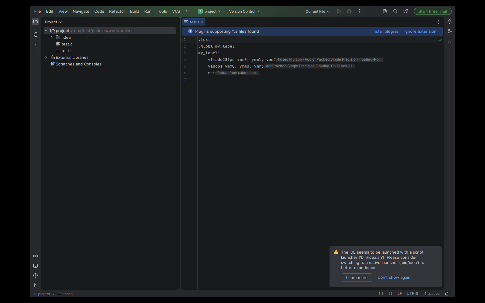
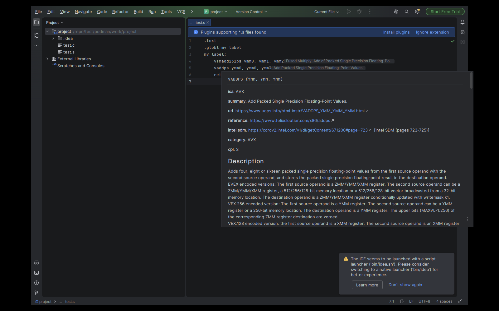
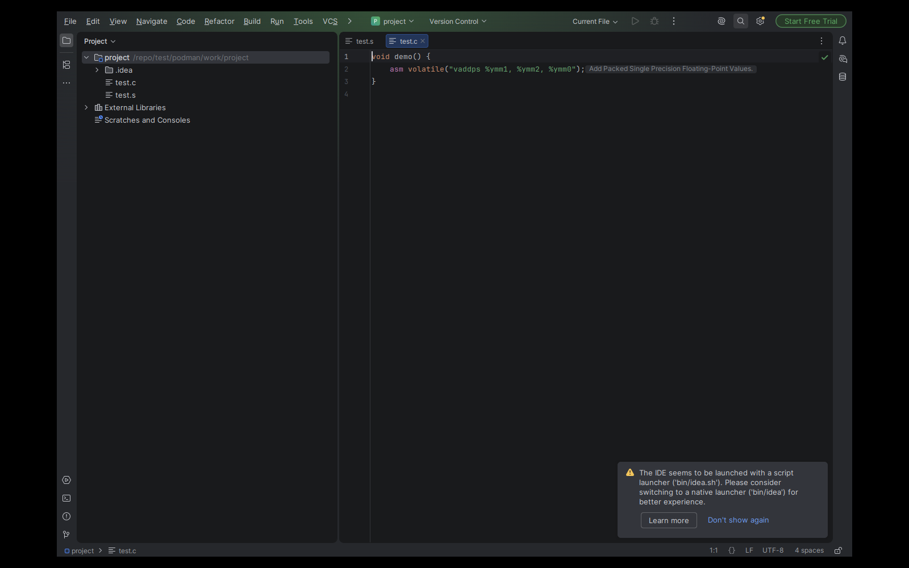
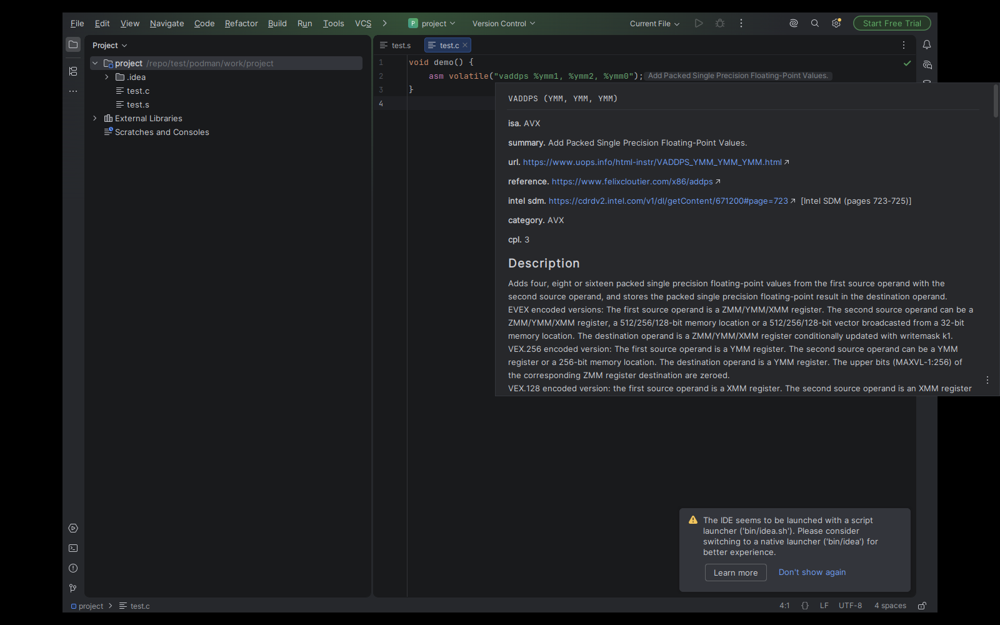

# simdref for JetBrains IDEs






This plugin shows SIMD instruction documentation in JetBrains IDEs. It runs the `simdref-lsp` language server for hover text and a one-line brief in an inlay hint.

The plugin is active in assembly files (`.s`, `.S`, `.asm`).
Also in C and C++ files (`.c`, `.cc`, `.cpp`, `.cxx`, `.c++`, `.h`, `.hpp`, `.hh`, `.hxx`, `.cu`, `.cuh`).
In C and C++, the server gives hints only in `asm` string literals.
The IDE has no NASM file type without another plugin, so `.nasm` files get no hints.

Quick Documentation shows the full simdref page from the local catalog. It works offline. The shortcut is Ctrl+Q on Linux and Windows, F1 on macOS.

## Supported IDEs

The plugin uses the native JetBrains LSP API (`com.intellij.modules.lsp`). The IDE version must be 2026.1 through 2026.2.

- CLion, IntelliJ IDEA (unified), and other JetBrains IDEs that ship the LSP API. IDEA Community and Android Studio do not.

Inlay hints: the plugin installs the newest simdref, and upgrades it once a day. A new simdref version takes effect at the next server start.
The server starts on the next file open.
The IDE caps LSP inlay hints at 42 characters. The plugin increases this limit to 100 (the platform maximum) through `LspInlayHintSupport.getMaxInlayHintChars`.

## Automatic install

The plugin looks for the server in this sequence:

1. `simdref-lsp` on `PATH`.
2. A previous install in `<IDE system dir>/simdref`.
3. The plugin downloads `uv` into `<IDE system dir>/simdref` and checks its SHA-256 against the hash pinned in code. It runs `uv tool install simdref` and `isa update` there as a background task.

On an error, the plugin shows a notification with a link to these instructions. The next file open retries.

The plugin has no settings.

## Manual install

```
uv tool install simdref
isa update
```

`pip install simdref` also works. Run `isa update` and start the IDE again (the server opens the catalog only at start). Instructions: https://github.com/simd-labs/simdref

## Troubleshooting

If `simdref-lsp` is on `PATH`, the plugin uses it. For inlay hints, upgrade: `uv tool upgrade simdref`.

## Development install

```
./gradlew buildPlugin
```

Open Settings > Plugins > gear icon > Install Plugin from Disk. Select `build/distributions/simdref-0.1.0.zip`.

Other tasks: `./gradlew test`, `./gradlew verifyPlugin`, `./gradlew runIde`.

## Headless containers

CLion and IU/free IDEA SIGSEGV in a plain rootless container (after the Data Sharing dialog). Use the host IDE or a VM for end-to-end checks.

## License

GPL-3.0-or-later.
